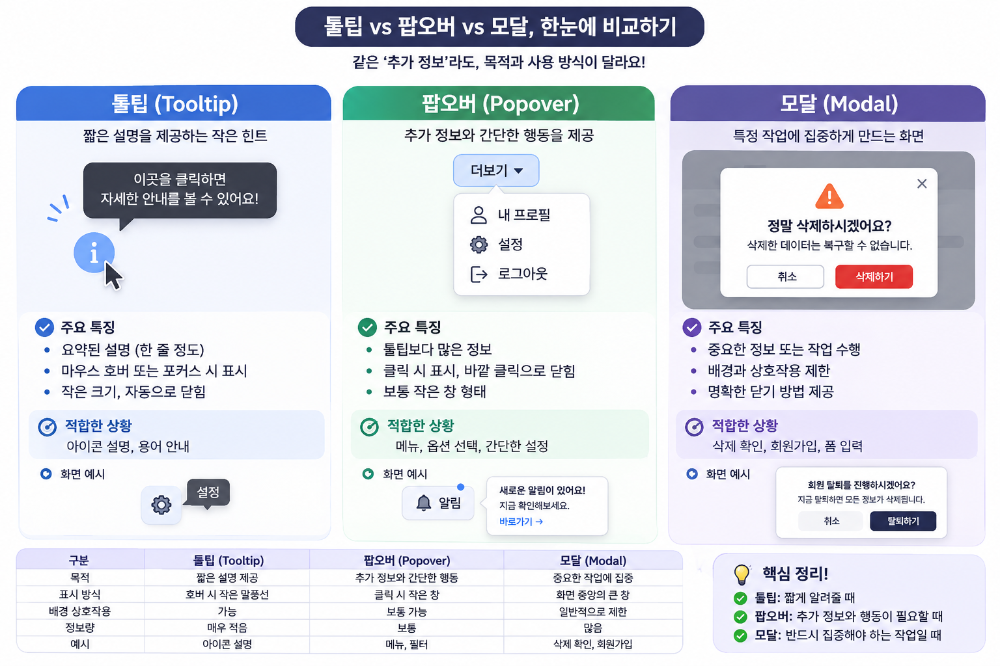

# **피드백과 보조 인터랙션을 만드는 컴포넌트**

## **1. 웹 UI에서 피드백이 중요한 이유**

사용자가 버튼을 눌렀을 때 아무런 반응이 없다면 정상적으로 처리되었는지 알 수 없어 불안감을 느낄 수 있어.

따라서 UI는 **사용자의 행동과 시스템의 현재 상태를 시각적으로 전달**해야 해.

대표적인 피드백 컴포넌트:

- 얼럿(Alert)
- 토스트(Toast)
- 배지(Badge)
- 로딩(Loading)
- 프로그레스 바(Progress Bar)
- 툴팁(Tooltip)
- 팝오버(Popover)
- 모달(Modal)

## **2. 피드백 컴포넌트 비교**

각 컴포넌트는 사용자의 작업 흐름을 방해하는 정도가 달라.

| 컴포넌트      | 주요 목적               | 흐름 방해 정도   |
| ------------- | ----------------------- | ---------------- |
| 배지          | 상태나 변화 표시        | 매우 낮음        |
| 토스트        | 행동 결과 전달          | 낮음             |
| 로딩          | 처리 중인 상태 전달     | 상황에 따라 다름 |
| 프로그레스 바 | 작업 진행률 전달        | 낮음             |
| 툴팁          | 짧은 보조 설명          | 낮음             |
| 팝오버        | 추가 정보와 간단한 행동 | 중간             |
| 얼럿          | 주의와 결정 요구        | 높음             |
| 모달          | 특정 정보와 행동에 집중 | 높음             |

## **3. 주요 컴포넌트별 정리**

### **① 얼럿(Alert)**

사용자의 주의가 필요하거나 특정 결정을 요구하는 메시지.

**사용 상황**

- 계정이나 프로젝트 삭제
- 저장하지 않은 상태로 페이지 이동
- 중요한 설정 변경
- 결제 및 플랜 업데이트

**설계 시 주의사항**

- 반드시 확인이 필요한 상황에만 사용
- 어떤 행동이 실행되는지 버튼 문구로 명확하게 표현
- 위험한 행동은 다른 버튼과 구분
- 더 안전한 선택을 시각적으로 강조

예시: `삭제` / `취소` 버튼

### **② 토스트(Toast)**

사용자의 행동 결과를 가볍게 전달하는 메시지. 화면의 흐름을 막지 않고 잠시 나타났다가 사라져.

**사용 상황**

- 저장 완료
- 삭제 완료
- 링크 복사
- 설정 변경
- 작업 실패

**대표 유형**

- 성공: 저장되었습니다.
- 오류: 저장하지 못했습니다.
- 정보: 새로운 버전이 업데이트되었습니다.
- 액션 포함: 삭제되었습니다. `실행 취소`

**설계 시 주의사항**

- 일반적인 표시 시간은 약 3\~5초
- 주요 콘텐츠나 입력 영역을 가리지 않도록 배치
- 너무 자주 사용하지 않기
- 중요한 행동을 토스트 안에서만 제공하지 않기

### **③ 배지(Badge)**

상태나 새로운 변화가 있다는 사실을 작게 표시하는 컴포넌트.

**사용 상황**

- 읽지 않은 알림 개수
- 새로운 메시지
- 승인 완료
- 검토 필요
- 상품 재고 상태

| 색상   | 일반적인 의미                 |
| ------ | ----------------------------- |
| 빨간색 | 긴급, 오류, 읽지 않은 알림    |
| 파란색 | 안내, 정보, 새로운 소식       |
| 노란색 | 주의, 확인 필요               |
| 초록색 | 정상, 완료, 승인              |
| 회색   | 비활성화, 비로그인, 보조 상태 |

**설계 시 주의사항**

- 색상만으로 상태를 전달하지 않기
- 텍스트, 아이콘, 숫자 등을 함께 활용
- 같은 서비스 안에서 색상의 의미를 일관되게 유지
- 배지를 지나치게 많이 사용하지 않기

### **④ 로딩(Loading)**

데이터 처리나 작업이 진행 중이라는 사실을 알려주는 피드백.

| 유형            | 특징                              | 적합한 상황                          |
| --------------- | --------------------------------- | ------------------------------------ |
| 스피너          | 처리 중임을 표시                  | 짧은 작업, 진행률을 알기 어려운 작업 |
| 스켈레톤 UI     | 콘텐츠가 표시될 영역을 미리 표현  | 카드 목록 등 콘텐츠 로딩             |
| 로티 애니메이션 | 브랜드 분위기를 표현              | 개성 있는 로딩 화면                  |
| 버튼 내부 로딩  | 클릭한 버튼 안에서 처리 상태 표시 | 저장, 로그인 등 버튼 작업            |

**설계 시 주의사항**

- 스켈레톤은 실제 콘텐츠의 크기와 형태를 반영
- 로딩 애니메이션은 전달력과 성능을 고려
- 버튼 내부 로딩 중에는 중복 클릭 방지

### **⑤ 프로그레스 바(Progress Bar)**

작업의 현재 진행률이나 단계를 보여주는 컴포넌트.

**사용 상황**

- 파일 업로드 및 다운로드
- 설문 작성
- 회원가입 단계
- 결제 및 온보딩

표시 예시:

- `65% 업로드됨`
- `총 4단계 중 2단계`

**설계 시 주의사항**

- 실제 작업 상태와 진행률을 일치시킬 것
- 현재 진행률과 완료된 단계 표시
- 남은 단계나 예상 소요 시간 등을 안내할 수 있음

### **⑥ 툴팁(Tooltip)**

아이콘이나 버튼의 의미를 보완하는 짧은 설명.

**사용 상황**

- 아이콘 버튼의 기능 설명
- 생소한 용어 안내
- 비활성화된 기능의 이유
- 입력 조건 안내

**설계 시 주의사항**

- 가능한 한 한 줄 이내로 짧게 작성
- 툴팁 없이도 기본 기능을 이해할 수 있어야 함
- 데스크톱의 호버뿐 아니라 키보드 포커스와 모바일 터치도 고려

### **⑦ 팝오버(Popover)**

특정 요소를 클릭했을 때 열리는 보조 정보 창. 툴팁보다 많은 정보를 담을 수 있고 버튼이나 링크도 포함할 수 있어.

**사용 상황**

- 사용자 프로필 요약
- 일정 미리보기
- 알림 상세 정보
- 필터 설정
- 간단한 설정 변경

**닫는 방법**

- 닫기 버튼
- 열었던 버튼 다시 선택
- 바깥 영역 선택
- ESC 키

### **⑧ 모달(Modal)**

현재 화면 위에 표시되어 특정 정보나 행동에 집중하도록 만드는 컴포넌트.

모달이 열리면 일반적으로 뒤에 있는 페이지와 상호작용할 수 없어.

**사용 상황**

- 중요한 정보 확인
- 삭제 확인
- 로그인 및 회원가입
- 간단한 프로젝트 생성
- 짧은 폼 작성
- 이미지 및 콘텐츠 상세 보기

**기본 구성**

- 제목과 설명
- 본문 콘텐츠
- 입력 요소
- 주요 행동 버튼
- 취소 또는 닫기 버튼
- 배경 오버레이

**설계 시 주의사항**

- 우측 상단 닫기 버튼, 취소 버튼, ESC 키 등 닫는 방법 제공
- 작성 중인 데이터가 사라질 수 있다면 닫기 전 확인
- 삭제 확인처럼 중요한 상황은 오버레이 클릭으로 닫히는 동작을 제한할 수 있음

모달 안에 정보와 기능이 너무 많거나 여러 단계의 작업이 필요하다면 별도 페이지가 더 적합할 수 있어.

## **4. 팝오버와 모달 비교**

| 구분          | 팝오버                  | 모달                       |
| ------------- | ----------------------- | -------------------------- |
| 표시 위치     | 선택한 요소 주변        | 화면 중앙 또는 전체 영역   |
| 배경 상호작용 | 가능한 경우가 많음      | 일반적으로 제한            |
| 정보량        | 비교적 적음             | 더 많은 콘텐츠와 입력 가능 |
| 주요 목적     | 보조 정보와 간단한 행동 | 특정 작업에 집중           |
| 오버레이      | 보통 없음               | 일반적으로 사용            |
| 흐름 방해     | 중간                    | 높음                       |

**얼럿과 모달의 차이**

- 얼럿: 사용자의 주의와 결정을 요구하는 메시지
- 모달: 정보와 행동을 담아 특정 작업에 집중시키는 화면 구조
- 얼럿은 모달 형태로 표시될 수 있지만, 모든 모달이 얼럿은 아님

## **4. 툴팁 VS 팝오버 vs 모달**

- Tooltip: 짧은 설명만 필요할 때
- Popover: 추가 정보와 간단한 행동이 필요할 때
- Modal: 사용자가 현재 작업에 집중해야 할 때

프론트엔드에서는 Tooltip = hover/focus, Popover = click, Modal = dialog

## **5. 상황에 맞는 컴포넌트 선택**

| 상황                             | 적합한 컴포넌트     |
| -------------------------------- | ------------------- |
| 반드시 결정을 내려야 함          | 얼럿, 모달          |
| 작업 결과를 가볍게 안내          | 토스트              |
| 새로운 상태가 있음을 표시        | 배지                |
| 작업이 진행 중임을 표시          | 스피너, 스켈레톤 UI |
| 완료까지 남은 진행률 표시        | 프로그레스 바       |
| 짧은 설명 제공                   | 툴팁                |
| 추가 정보와 간단한 행동 제공     | 팝오버              |
| 현재 페이지에서 특정 작업에 집중 | 모달                |

## **6. 피드백 UI에서 자주 발생하는 실수**

- 모든 메시지를 모달로 표시하기
- 중요한 내용을 자동으로 사라지는 토스트로만 전달하기
- 토스트 표시 시간이 너무 짧기
- 토스트가 입력창이나 주요 버튼을 가리기
- 배지를 지나치게 많이 사용하기
- 로딩 중 중복 클릭을 허용하기
- 진행률을 알 수 있는 작업에 스피너만 사용하기
- 툴팁에 긴 설명을 넣기
- 호버에만 의존하기
- 모달 안에 지나치게 많은 기능을 넣기
- 모달을 닫는 방법을 명확하게 제공하지 않기

## **핵심 요약**

1. **피드백 UI의 목적은 사용자 행동에 대한 시스템 상태를 전달하는 것.**
2. 메시지의 중요도와 사용자가 해야 할 행동에 따라 컴포넌트를 선택해야 함.
3. 얼럿과 모달은 사용자의 흐름을 강하게 중단시키므로 필요한 상황에만 사용.
4. 스피너는 처리 중임을, 프로그레스 바는 진행 정도를 전달.
5. 툴팁은 짧은 설명, 팝오버는 추가 정보와 간단한 행동에 적합.
6. 모바일 터치와 키보드 포커스 등 다양한 입력 방식도 고려해야 함.

**프론트엔드 연결**

- Alert / Dialog: 삭제 확인, 페이지 이탈 확인
- Toast: 저장 성공, API 오류 안내
- Badge: 알림 개수, 게시물 상태
- Spinner / Skeleton: API 데이터 로딩
- Progress: 파일 업로드 진행률
- Tooltip / Popover: 보조 설명, 필터 설정
- Modal: 간단한 생성 폼, 상세 정보

출처: [디자인베이스 – 피드백과 보조 인터랙션을 만드는 컴포넌트](https://designbase.co.kr/course/web-design-ui-foundations/lesson/feedback-interaction-ui-components-2/?utm_source=chatgpt.com)
