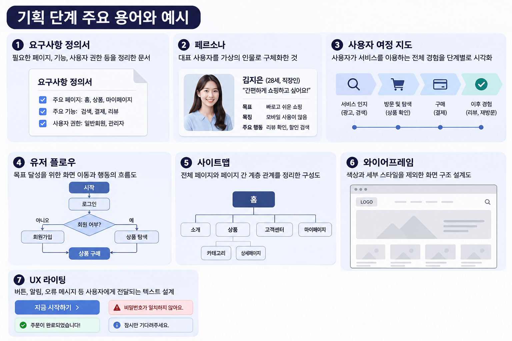
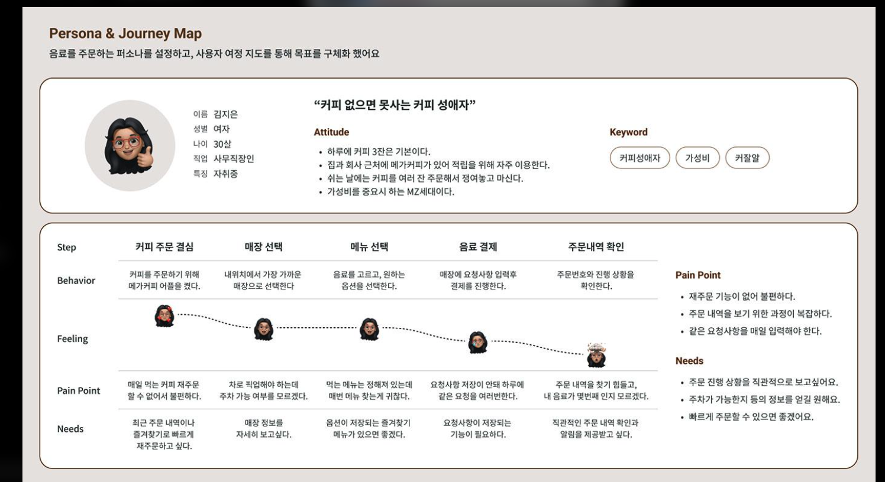
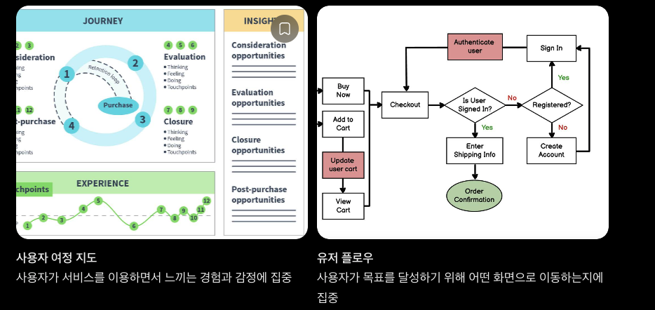
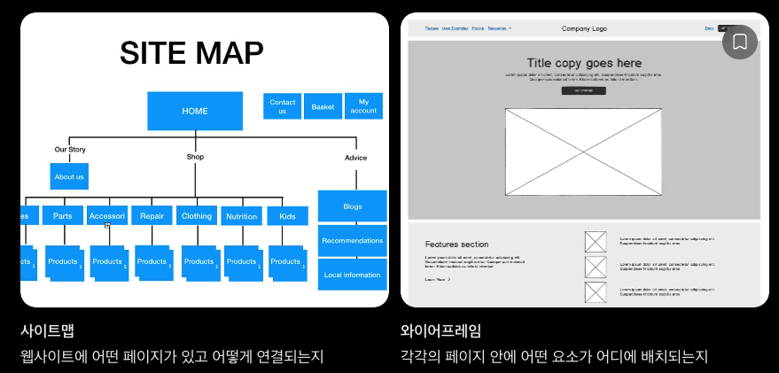

# **2강. 웹사이트 제작의 전체 흐름 파악하기**

디자인베이스 · 웹 디자인 기초와 UI 설계 원리

## **1. 핵심 개념**

**웹사이트 제작은 기획 → 디자인 → 개발 → QA → 배포 → 운영의 6단계로 이루어진다.**

- 웹사이트는 디자인 화면만 완성한다고 만들어지는 것이 아니다.
- 각 단계는 서로 연결되어 있으며, 프로젝트 규모에 따라 담당자가 달라질 수 있다.
- 배포 이후에도 사용자 데이터와 피드백을 바탕으로 지속적으로 개선한다.

## **2. 웹사이트 제작의 6단계**

1. **기획 (Planning)**

   무엇을, 왜, 누구를 위해 만들 것인지 결정한다.

2. **디자인 (Design)**

   사용자가 정보를 이해하고 행동할 수 있도록 화면과 경험을 설계한다.

3. **개발 (Development)**

   디자인을 실제 작동하는 코드와 기능으로 구현한다.

4. **QA (Quality Assurance)**

   디자인과 기능이 의도대로 구현되었는지 검증한다.

5. **배포 (Deployment)**

   완성된 웹사이트를 사용자에게 공개한다.

6. **운영 (Operation)**

   사용자 데이터와 피드백을 바탕으로 문제를 발견하고 개선한다.

운영 과정에서 새로운 문제가 발견되면 다시 기획과 디자인 단계로 돌아가 개선한다.

## **3. 단계별 주요 개념**

### **① 기획 (Planning)**

웹사이트의 목적과 범위를 정하는 단계다.

| 용어             | 설명                                                       |
| ---------------- | ---------------------------------------------------------- |
| 요구사항 정의서  | 필요한 페이지, 기능, 사용자 권한 등을 정리한 문서          |
| 페르소나         | 대표 사용자를 가상의 인물로 구체화한 것                    |
| 사용자 여정 지도 | 사용자가 서비스를 이용하는 전체 경험을 단계별로 시각화     |
| 유저 플로우      | 목표 달성을 위한 화면 이동과 행동의 흐름도                 |
| 사이트맵         | 전체 페이지와 페이지 간 계층 관계를 정리한 구성도          |
| 와이어프레임     | 색상과 세부 스타일을 제외한 화면 구조 설계도               |
| UX 라이팅        | 버튼, 알림, 오류 메시지 등 사용자에게 전달되는 텍스트 설계 |

**헷갈리기 쉬운 개념 비교**

- 사용자 여정 지도: 서비스 이용 전반의 경험과 감정에 집중
- 유저 플로우: 실제 화면 이동과 행동의 연결에 집중
- 사이트맵: 웹사이트 전체 페이지 구조에 집중
- 와이어프레임: 개별 화면의 구조와 정보 배치에 집중

### **② 디자인 (Design)**

사용자가 정보를 쉽게 이해하고 자연스럽게 행동할 수 있도록 화면과 경험을 설계한다.

| 용어              | 설명                                                                  |
| ----------------- | --------------------------------------------------------------------- |
| 스타일 가이드     | 컬러, 폰트, 아이콘, 로고 등의 시각적 규칙                             |
| 프로토타입        | 클릭, 화면 전환 등을 연결해 사용 흐름을 시뮬레이션한 결과물           |
| 웹 접근성         | 누구나 웹사이트의 정보와 기능을 인식하고 사용할 수 있도록 설계하는 것 |
| 디자인 시스템     | 디자인 토큰, 컴포넌트, UI 패턴, 사용 가이드를 연결한 설계 체계        |
| 마이크로 인터랙션 | 버튼 클릭, 좋아요, 로딩 등 사용자 행동에 반응하는 작은 인터랙션       |
| 웹폰트            | 서버에서 불러와 사용자 기기에 지정된 글꼴을 표시하는 폰트             |
| 스켈레톤 UI       | 콘텐츠 로딩 전에 콘텐츠가 표시될 자리를 미리 보여주는 UI              |

**스타일 가이드와 디자인 시스템의 차이**

| 구분 | 스타일 가이드       | 디자인 시스템                           |
| ---- | ------------------- | --------------------------------------- |
| 목적 | 시각적 일관성 유지  | 디자인과 개발의 일관성 및 재사용성 확보 |
| 구성 | 컬러, 폰트, 로고 등 | 디자인 토큰, 컴포넌트, 패턴, 가이드     |
| 범위 | 시각적 규칙         | 실제 UI와 개발 코드까지 연결            |

### **디자인 핸드오프 (Handoff)**

완성된 디자인을 개발자에게 전달하는 과정이다.

단순히 Figma 링크를 공유하는 것이 아니라 디자인 의도와 동작 원칙까지 전달해야 한다.

**핵심 준비 사항 4가지**

1. 디자인 정합성: 컴포넌트 이름, 간격, 컬러, 타이포그래피의 일관성
2. 컴포넌트 상태 정의: Default, Hover, Focus, Active, Disabled, Loading, Error, Success
3. 반응형 기준 공유: 화면 크기에 따른 레이아웃 변경 규칙
4. 에셋 관리: SVG, PNG, JPG, WebP 등 이미지 형식과 해상도, 파일명 규칙

### **③ 개발 (Development)**

디자인을 코드로 구현하고 API와 데이터베이스 등을 연결하는 단계다.

| 용어           | 설명                                                |
| -------------- | --------------------------------------------------- |
| 프론트엔드     | 사용자가 브라우저에서 직접 보고 조작하는 화면 구현  |
| 백엔드         | 서버에서 데이터와 비즈니스 로직 처리                |
| 브레이크포인트 | 화면 너비에 따라 레이아웃이 변경되는 기준           |
| API            | 프론트엔드와 백엔드 또는 서비스 간 데이터 통신 규약 |
| 데이터베이스   | 회원, 게시물, 상품 등의 데이터를 저장하는 공간      |
| 로깅과 트래킹  | 버튼 클릭, 회원가입, 구매 등 사용자 행동 기록       |
| 성능 최적화    | 웹사이트의 로딩과 동작 속도를 개선하는 작업         |
| 레이지 로딩    | 필요한 콘텐츠를 필요한 시점에 불러오는 방식         |

**성능 최적화 방법**

- 이미지 크기와 포맷 최적화
- 사용하지 않는 웹폰트 굵기 제외
- 불필요한 애니메이션 최소화
- 콘텐츠 우선순위에 따라 리소스 로딩
- 레이지 로딩 적용

### **④ QA (Quality Assurance)**

구현된 웹사이트가 디자인과 기능 측면에서 정상적으로 동작하는지 검증한다.

| 용어            | 설명                                                |
| --------------- | --------------------------------------------------- |
| 크로스 브라우징 | 다양한 브라우저와 운영체제에서 정상 작동하는지 확인 |
| 버그 리포트     | 발견된 문제와 재현 방법 등을 정리한 문서            |

**주요 QA 확인 사항**

- 디자인 시안과 실제 화면의 일치 여부
- 버튼과 입력창의 상태 및 기능
- 모바일과 태블릿 레이아웃
- 긴 텍스트와 다양한 데이터 대응
- 키보드 접근성과 접근성
- 회원가입, 검색, 결제 기능

버그 리포트에는 발생 페이지, 기기와 브라우저, 재현 순서, 기대 결과, 실제 결과 등을 기록한다.

### **⑤ 배포 (Deployment)**

완성된 웹사이트를 실제 사용자에게 공개하는 단계다.

| 용어          | 설명                                                      |
| ------------- | --------------------------------------------------------- |
| HTTPS         | 데이터를 암호화하여 주고받는 통신 방식                    |
| SSL 인증서    | 암호화 연결을 구성하는 데 사용되는 인증서                 |
| 스테이징 환경 | 운영 환경과 유사한 조건에서 최종 테스트하는 환경          |
| 롤백          | 문제가 발생했을 때 이전의 안정적인 버전으로 되돌리는 작업 |
| 파비콘        | 브라우저 탭과 북마크 등에 표시되는 작은 아이콘            |
| OG 이미지     | 링크를 SNS나 메신저에 공유할 때 표시되는 대표 이미지      |

### **⑥ 운영 (Operation)**

배포 이후 사용자 행동과 피드백을 분석하고 웹사이트를 지속적으로 개선하는 단계다.

| 용어                  | 설명                                              |
| --------------------- | ------------------------------------------------- |
| Google Analytics (GA) | 웹사이트 방문자의 유입과 행동을 분석하는 도구     |
| 세션                  | 사용자의 하나의 방문 활동 묶음                    |
| 이탈률                | 의미 있는 상호작용 없이 세션을 종료한 비율        |
| 전환율                | 전체 방문자 중 목표 행동을 완료한 사용자의 비율   |
| A/B 테스트            | 두 가지 이상의 버전을 비교해 성과를 확인하는 방법 |

### **4. 헷갈리기 쉬운 핵심 개념 비교**

| 비교                  | 차이                                                           |
| --------------------- | -------------------------------------------------------------- |
| 프론트엔드 vs 백엔드  | 사용자 화면 구현 vs 서버 데이터 및 로직 처리                   |
| QA vs 크로스 브라우징 | 전체 품질 검증 vs 브라우저·OS별 호환성 검증                    |
| 스테이징 vs 운영 환경 | 배포 전 테스트 환경 vs 실제 서비스 환경                        |
| 이탈률 vs 전환율      | 의미 있는 상호작용 없이 종료한 비율 vs 목표 행동을 완료한 비율 |
| 롤백 vs 배포          | 이전 버전으로 복구 vs 새 버전을 공개                           |

## **5. 웹디자이너가 전체 과정을 알아야 하는 이유**

- 프로젝트 목적에 맞는 디자인 결정을 내릴 수 있다.
- 개발하기 어려운 구조를 미리 발견할 수 있다.
- 로딩, 오류, 빈 화면 등 실제 서비스에 필요한 상태를 설계할 수 있다.
- 개발자에게 디자인 의도를 정확하게 전달할 수 있다.
- 배포 이후 데이터를 바탕으로 디자인을 개선할 수 있다.

## **핵심 요약**

**웹사이트 제작의 전체 흐름**

# **기획 → 디자인 → 개발 → QA → 배포 → 운영**

1. 기획: 무엇을, 왜, 누구를 위해 만들 것인가?
2. 디자인: 사용자가 어떻게 이해하고 행동할 것인가?
3. 개발: 실제로 어떻게 구현할 것인가?
4. QA: 의도대로 작동하는가?
5. 배포: 사용자에게 공개할 준비가 되었는가?
6. 운영: 실제 사용자 데이터를 바탕으로 어떻게 개선할 것인가?

**가장 중요한 내용:** 웹디자인은 화면을 만드는 작업에서 끝나지 않는다. 기획부터 개발, 배포, 운영까지 연결되는 전체 사용자 경험을 설계하는 일이다.

출처: [디자인베이스 – 웹사이트 제작의 전체 흐름 파악하기](https://designbase.co.kr/course/web-design-ui-foundations/lesson/web-design-1-2-2)
